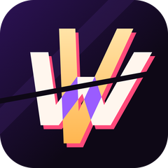

  

<h1 align="center">Velvet Weaver</h1>

  Indie studio making story-driven games for adults (18+) on our own Rust engine. 
  Fantasy worlds, characters with a past, and every game in 15 languages.

  
  
  

---

### Open source

**[Velvet Engine](https://github.com/dadtnttn/velvet-engine)**: a modular Rust engine for visual novels, narrative adventures, 2D play and toon-shaded 3D worlds. Our games run on it.

### Games

| Game | What it is |
|------|------------|
| **Demon Queen** | Dark fantasy in 3D. You wake up as the Queen of a fallen castle: rebuild it, hold court, win allies over and fight a war for the continent. |
| **Behind the Paper Door** | An anthology of short visual novels set in modern Japan, one story per wife. |
| **Lustlands** | A card-crafting game about a village of monster girls. |

Builds, devlogs and early versions are on [Patreon](https://www.patreon.com/VelvetWeaver) and [our website](https://velvetweaver.xyz).

All characters are adults. The games themselves are not hosted on GitHub.
